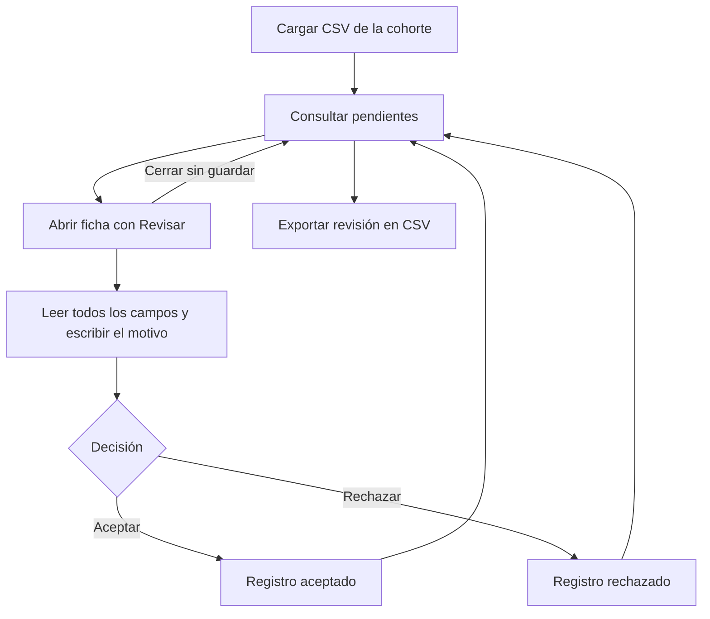

# Patient Discovery · Wiki de uso

Aplicación web para consultar una cohorte de pacientes desde un CSV, revisar sus registros y exportar las decisiones con su motivo.

**[Abrir la aplicación](https://kluna1998.github.io/patient-discovery/)** · **[Abrir con el editor del diccionario](https://kluna1998.github.io/patient-discovery/?debug=1)**

## Índice

- [Inicio rápido](#inicio-rápido)
- [Consultar la tabla](#consultar-la-tabla)
- [Revisar un paciente](#revisar-un-paciente)
- [Exportar la revisión](#exportar-la-revisión)
- [Qué se guarda y dónde](#qué-se-guarda-y-dónde)
- [TODO · Mejoras pendientes](#todo--mejoras-pendientes)

## Inicio rápido

1. Abre la aplicación y selecciona un CSV con los registros de la cohorte.
2. Consulta los pacientes pendientes. Usa la búsqueda, la ordenación y el selector de columnas para explorar los datos.
3. Pulsa **Revisar** en la primera columna para abrir la ficha completa de un paciente.
4. Lee la información, escribe el motivo al final y pulsa **Aceptar** o **Rechazar**.
5. Repite el proceso y pulsa **Exportar revisión en CSV** para descargar el resultado. Puedes exportar aunque queden registros pendientes.

**Antes de recargar, cerrar la pestaña o cargar otra cohorte, exporta la revisión.** Los registros y las decisiones de la sesión se mantienen en memoria y se pierden al hacerlo. El archivo exportado permite conservar los resultados, pero todavía no permite reanudar automáticamente una revisión en la aplicación.

## Consultar la tabla

### Estados y progreso

Las tarjetas **Pendiente**, **Aceptado** y **Rechazado** filtran la tabla por estado. Sus contadores corresponden a toda la cohorte; la búsqueda de la tabla no cambia esos totales.

El progreso cuenta los aceptados y rechazados sobre el total de registros.

### Columnas, búsqueda y ordenación

| Control | Funcionamiento |
| --- | --- |
| Primera columna: Revisión | Muestra el estado y el botón **Revisar**. El botón queda deshabilitado cuando ya existe una decisión. |
| Columnas del CSV | Inicialmente se muestran las cinco primeras, en el orden del archivo, o todas si hay menos de cinco. |
| Columnas visibles | Permite mostrar u ocultar los campos del CSV. Revisión y Justificación permanecen visibles. |
| Buscar registros | Filtra los valores de la cohorte dentro del estado seleccionado; también puede encontrar valores de columnas ocultas. |
| Encabezado de una columna del CSV | Permite cambiar su ordenación. La ordenación es alfanumérica; las fechas no se interpretan como un tipo específico. |
| Icono de información | Muestra una burbuja con la descripción y el nombre original al pasar el cursor o enfocar el icono con el teclado. También se puede tocar en móvil. |
| Justificación | Muestra el motivo guardado. Si aparece recortado, pasa el cursor sobre el texto para consultarlo. |
| Anterior / Siguiente | Recorre los resultados en páginas de diez registros. |
| Restablecer vista | Quita la búsqueda y la ordenación, vuelve a la primera página y restaura las cinco primeras columnas. |

## Revisar un paciente

**Revisar** abre una ficha tipo documento, amplia y desplazable. Contiene todos los campos del registro en el orden del CSV, incluidos los ocultos en la tabla.

Cerrar con la **X** o pulsar **Escape** descarta el motivo sin guardar una decisión. Actualmente no se puede volver a abrir la ficha de un registro ya revisado desde su botón **Revisar**, ni modificar su decisión.

## Exportar la revisión

**Exportar revisión en CSV** descarga un archivo llamado `<nombre_original>_reviewed.csv`. Incluye **todos los registros y todas las columnas originales**, aunque la tabla tenga filtros o columnas ocultas.

Al final añade tres columnas:

| Columna | Contenido |
| --- | --- |
| `review_status` | `pending`, `accepted` o `rejected`. |
| `review_reason` | Motivo guardado; vacío para los pendientes. |
| `reviewed_at` | Fecha y hora de la decisión en formato ISO y UTC; vacía para los pendientes. |

Si el archivo original ya contiene uno de estos nombres, se añade un sufijo (`_1`, `_2`, etc.) para evitar sobrescribirlo. Los títulos legibles del diccionario no sustituyen los encabezados originales en la exportación.

**Importar un CSV exportado no restaura las decisiones:** sus columnas se tratarán como datos de una nueva cohorte y los registros comenzarán como pendientes.

## Qué se guarda y dónde

El diccionario se gestiona editando `public/info_columns_dict.csv`: `column_name`, `readable_name`, `meaning`, `section` y `section_order`. Recarga la aplicación tras actualizar el archivo; en el sitio publicado es necesario publicar también el CSV actualizado. El editor provisional se activa con `?debug=1`: permite aplicar cambios durante la sesión y descargar el CSV. Al recargar se vuelve a cargar el archivo del proyecto; no hay guardado en el navegador ni versiones v1/v2. Las copias antiguas del navegador se ignoran y no se borran.

| Información | Almacenamiento | ¿Se conserva al recargar? |
| --- | --- | --- |
| Cohorte cargada | Memoria de la pestaña | No. |
| Decisiones y motivos | Memoria de la pestaña | No; exporta para conservarlos en un archivo. |
| Diccionario de columnas | `public/info_columns_dict.csv` del proyecto | Se carga desde el CSV al abrir la aplicación. |
| CSV descargados | Carpeta de descargas elegida por el navegador | Sí, como archivos independientes. |

## TODO · Mejoras pendientes

Las siguientes funcionalidades están pendientes; esta lista no describe capacidades ya disponibles.

- [ ] **Añadir un score sintético:** definir criterios y ponderaciones para ordenar candidatos en un ranking, con explicación del resultado.
- [ ] **Añadir un botón para modificar una decisión:** permitir corregir el estado o el motivo de un registro revisado.
- [ ] **Consultar fichas ya revisadas:** abrir la información completa desde Aceptados y Rechazados, mostrando también la decisión guardada.
- [ ] **Guardar y reanudar una revisión:** recuperar la cohorte y sus decisiones después de cerrar o recargar la aplicación.
- [ ] **Importar revisiones exportadas:** reconocer sus estados, motivos y fechas y asociarlos al registro correcto.
- [ ] **Avisar antes de perder trabajo:** confirmar la sustitución de una cohorte o la salida cuando haya decisiones sin exportar.
- [ ] **Conservar la vista de la tabla:** mantener búsqueda, ordenación y columnas seleccionadas al cambiar entre estados.
- [ ] **Añadir filtros por columna y tipos de datos:** filtrar rangos y ordenar fechas y números según un tipo definido para cada campo.
- [ ] **Organizar la ficha por secciones configurables:** agrupar los campos y definir su orden desde los metadatos del diccionario.
- [ ] **Trazabilidad de las decisiones:** registrar quién revisó cada paciente y el historial de cambios si se incorpora trabajo compartido.
