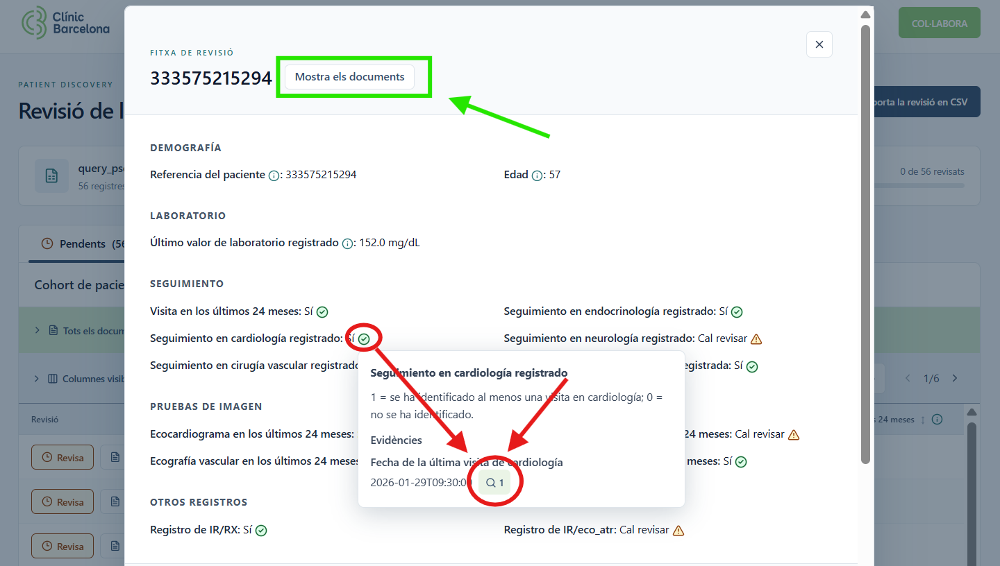
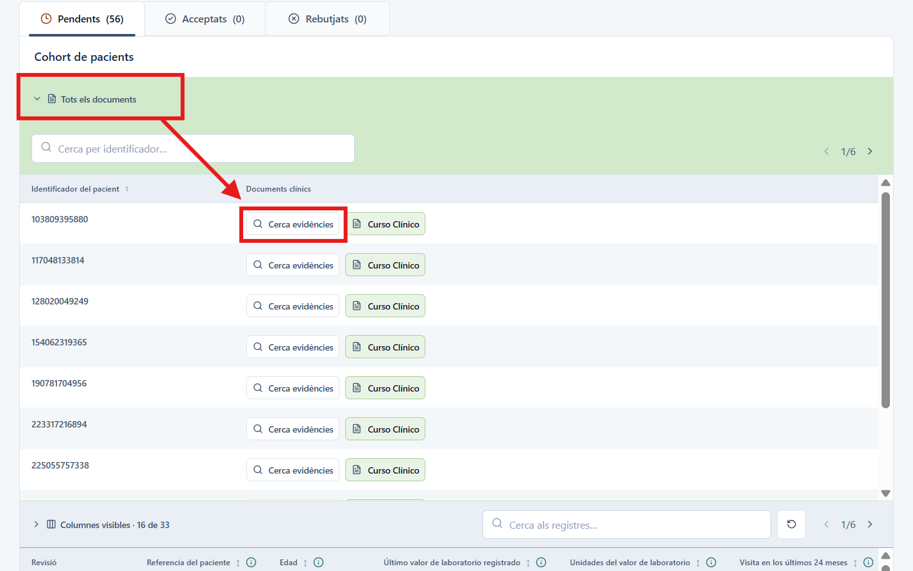
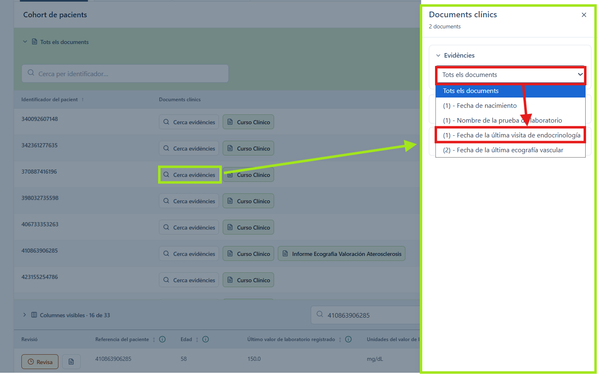
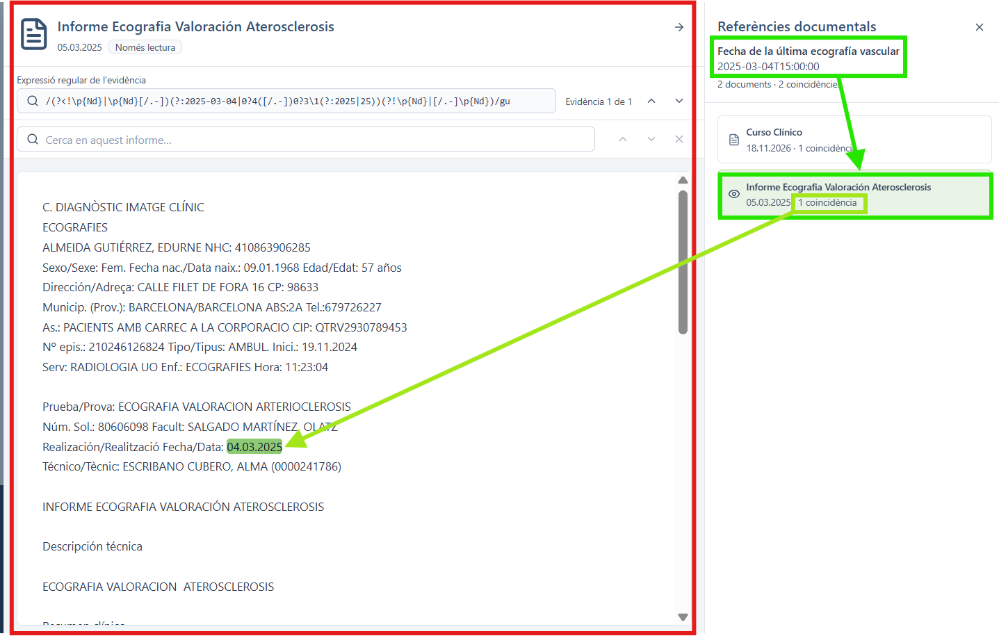

# Guía de uso de Patient Discovery

[https://kluna1998.github.io/patient-discovery/](https://kluna1998.github.io/patient-discovery/)

Patient Discovery permite revisar los registros de una cohorte, consultar sus informes y descargar las decisiones de revisión.

## 1. Abre el protocolo y carga la cohorte

1. Pulsa **Protocolo** para consultar los criterios de inclusión y exclusión. Puedes abrirlo antes o después de cargar el archivo. Ciérralo con la X o con **Esc**.
2. En **Cargar resultados**, selecciona el archivo CSV de la cohorte. La primera fila debe contener los nombres de las columnas y el archivo debe incluir al menos un registro.
3. Comprueba el nombre del archivo, el total de registros y el **Progreso de revisión**. El progreso cuenta los registros aceptados y rechazados.
4. Si aparece un error de carga, comprueba el separador, las comillas y que las filas tengan el mismo número de campos. Corrige el archivo y vuelve a seleccionarlo.

## 2. Encuentra el registro que quieres revisar

- **Pendientes**, **Aceptados** y **Rechazados** muestran los registros de cada estado. 
- **Columnas visibles** abre las casillas para mostrar u ocultar campos.
- **Ordena y pasa de página** pulsando un encabezado con flechas o usando las flechas de paginación. Puedes desplazar la tabla horizontalmente para ver más columnas.
- **Restablecer vista**, el botón con la flecha circular, limpia la búsqueda y la ordenación, recupera las columnas iniciales y vuelve a la primera página.
- Los iconos de **información** de los encabezados explican los campos incluidos en el diccionario de la cohorte.

## 3. Revisa y registra una decisión

1. Pulsa **Revisar** en la fila correspondiente. 
2. Consulta los datos por secciones. Los iconos de información muestran las explicaciones y las evidencias disponibles para el criterio. Si aparece **Sin datos**, el registro carece de un valor que la interfaz pueda mostrar para ese campo.
3. Lee los informes que necesites. Puedes abrir el listado con **Ver documentos** o seguir la lupa de una evidencia concreta desde el panel de ayuda del criterio.
4. Escribe, si procede, el **Motivo de la decisión**. Es opcional y admite hasta 2.000 caracteres.
5. Pulsa **Aceptar** o **Rechazar**. La fila pasa a su pestaña y se actualiza el progreso. **Cancelar** o la X cierran la ficha y descartan las ediciones sin guardar.
6. Para corregir una decisión, localiza el registro en **Aceptados** o **Rechazados**, pulsa **Modificar**, ajusta el estado o el motivo y elige **Guardar cambios**.

## 4. Consulta los documentos

| Si quieres… | Usa… |
| --- | --- |
| Leer los informes de una fila rápidamente | El icono de documento junto a **Revisar** o **Modificar**. |
| Leer informes mientras revisas un registro | **Ver documentos** dentro de la ficha. |
| Buscar un paciente en todo el listado de documentos | **Todos los documentos**. Busca por identificador, ordena desde la cabecera y pasa de página con las flechas del listado. |
| Abrir directamente un informe del listado global | Pulsa su botón en **Todos los documentos**. Se abre en un diálogo. Al cerrarlo con **Esc** o **Cerrar visor**, conservas la búsqueda y la página del listado. |

## 5. Localiza evidencias en los informes

Puedes buscar evidencias desde la ficha del registro o desde el listado general.

1. **Lupa de un criterio en la ficha.** Abre la ayuda del criterio y pulsa la lupa junto al valor de la evidencia para consultar sus referencias.
2. **Mostra els documents** en la ficha. Despliega **Evidències** y elige una entrada del selector para filtrar el listado.

   

3. **Cerca evidències** en **Tots els documents**. Pulsa el botón de la fila del paciente. Si aparece **Cap registre a la cohort**, puedes consultar sus informes y usar la búsqueda manual dentro de cada uno.

   

   

El número junto al nombre de una evidencia indica cuántos **documentos** tienen referencias. Al abrir un informe, las coincidencias se resaltan en el texto. Si aparece **Coincidència en la data de l’informe**, el resultado se basa en la fecha del documento y puede aparecer sin un fragmento resaltado.

El selector muestra las evidencias con referencias. Elige **Tots els documents** para volver al listado completo. Si el selector solo ofrece **Tots els documents**, comprueba los informes disponibles. Lee siempre la coincidencia en su contexto antes de tomar una decisión.

## 6. Exporta y cambia de cohorte

- Pulsa **Exportar revisión en CSV** y comprueba que se descargó el archivo terminado en `_reviewed.csv`. Incluye todos los registros, también los pendientes, junto con el estado, el motivo y la fecha de revisión cuando corresponda.
- Puedes exportar una revisión a medias. **Exporta antes de recargar o cerrar la página.** Las decisiones se conservan durante la sesión y el CSV exportado sirve como resultado, sin reanudar automáticamente la revisión al volver a abrirlo.
- Para cambiar de cohorte, pulsa **Cargar otro CSV**.
