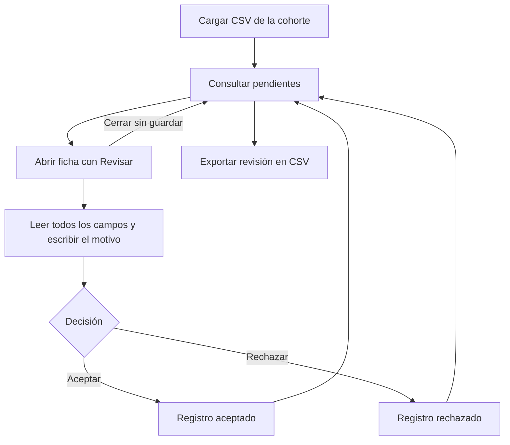

# Patient Discovery · Wiki de uso

Aplicación web para consultar una cohorte de pacientes desde un CSV, revisar sus registros y exportar las decisiones con su motivo.

**[Abrir la aplicación](https://kluna1998.github.io/patient-discovery/)** · **[Abrir con el editor del diccionario](https://kluna1998.github.io/patient-discovery/?debug=1)**

## Inicio rápido

1. Abre la aplicación y selecciona un CSV con los registros de la cohorte.
2. Consulta los pacientes pendientes. Usa la búsqueda, la ordenación y el selector de columnas para explorar los datos.
3. Pulsa **Revisar** en la primera columna para abrir la ficha completa de un paciente.
4. Lee la información, escribe el motivo al final y pulsa **Aceptar** o **Rechazar**.
5. Repite el proceso y pulsa **Exportar revisión en CSV** para descargar el resultado. Puedes exportar aunque queden registros pendientes.

**Antes de recargar, cerrar la pestaña o cargar otra cohorte, exporta la revisión.** Los registros y las decisiones de la sesión se mantienen en memoria y se pierden al hacerlo. El archivo exportado permite conservar los resultados, pero todavía no permite reanudar automáticamente una revisión en la aplicación.

## TODO · Mejoras pendientes

Las siguientes funcionalidades están pendientes; esta lista no describe capacidades ya disponibles.

- [ ] **Añadir un score sintético:** definir criterios y ponderaciones para ordenar candidatos en un ranking, con explicación del resultado.
- [ ] **Añadir un botón para modificar una decisión:** permitir corregir el estado o el motivo de un registro revisado.
- [ ] **Consultar fichas ya revisadas:** abrir la información completa desde Aceptados y Rechazados, mostrando también la decisión guardada.
- [ ] **Guardar y reanudar una revisión:** recuperar la cohorte y sus decisiones después de cerrar o recargar la aplicación.
- [ ] **Importar revisiones exportadas:** reconocer sus estados, motivos y fechas y asociarlos al registro correcto.
- [ ] **Avisar antes de perder trabajo:** confirmar la sustitución de una cohorte o la salida cuando haya decisiones sin exportar.
- [ ] **Conservar la vista de la tabla:** mantener búsqueda, ordenación y columnas seleccionadas al cambiar entre estados.
- [ ] **Añadir filtros por columna y tipos de datos:** filtrar rangos y ordenar fechas y números según un tipo definido para cada campo.
- [ ] **Organizar la ficha por secciones configurables:** agrupar los campos y definir su orden desde los metadatos del diccionario.
- [ ] **Trazabilidad de las decisiones:** registrar quién revisó cada paciente y el historial de cambios si se incorpora trabajo compartido.
