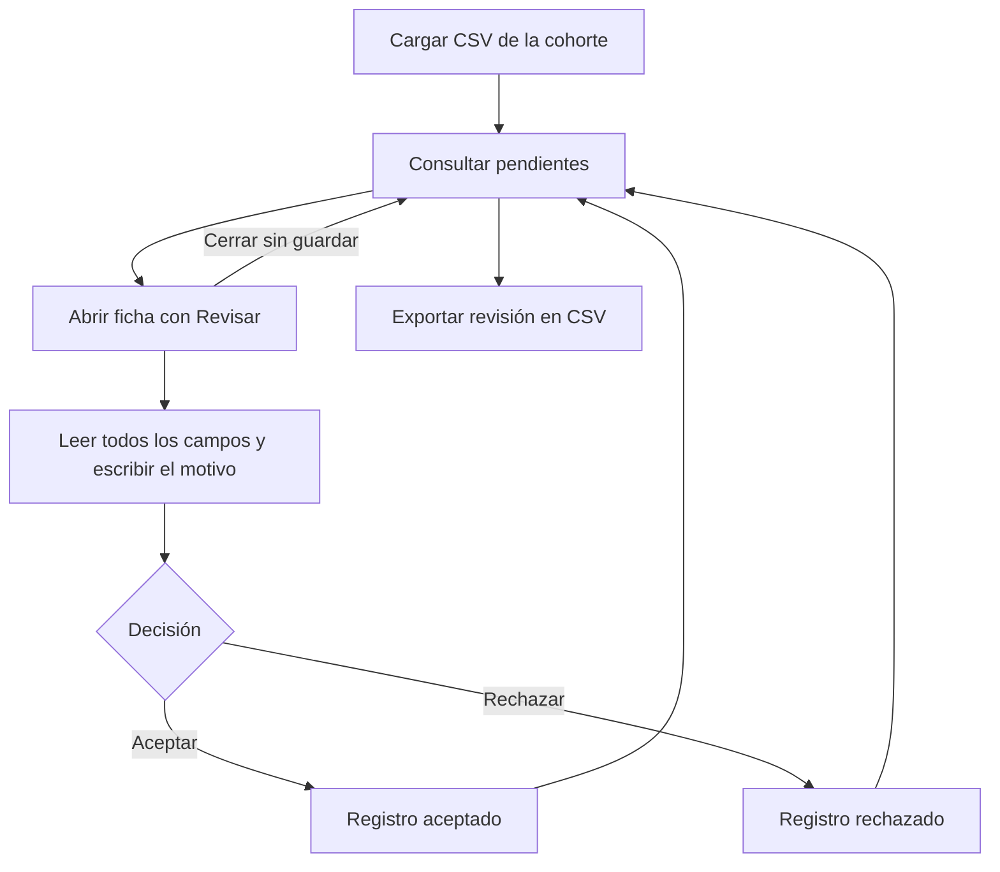

# Patient Discovery · Wiki de uso

Aplicación web para consultar una cohorte de pacientes desde un CSV, revisar sus registros y exportar las decisiones con su motivo.

**[Abrir la aplicación](https://kluna1998.github.io/patient-discovery/)** · **[Abrir con el editor del diccionario](https://kluna1998.github.io/patient-discovery/?debug=1)**

## Índice

- [Inicio rápido](#inicio-rápido)
- [Preparar y cargar una cohorte](#preparar-y-cargar-una-cohorte)
- [Consultar la tabla](#consultar-la-tabla)
- [Revisar un paciente](#revisar-un-paciente)
- [Exportar la revisión](#exportar-la-revisión)
- [Diccionario de columnas](#diccionario-de-columnas)
- [Qué se guarda y dónde](#qué-se-guarda-y-dónde)
- [Resolver problemas habituales](#resolver-problemas-habituales)
- [Desarrollo y despliegue](#desarrollo-y-despliegue)
- [TODO · Mejoras pendientes](#todo--mejoras-pendientes)

## Inicio rápido

1. Abre la aplicación y selecciona un CSV con los registros de la cohorte.
2. Consulta los pacientes pendientes. Usa la búsqueda, la ordenación y el selector de columnas para explorar los datos.
3. Pulsa **Revisar** en la primera columna para abrir la ficha completa de un paciente.
4. Lee la información, escribe el motivo al final y pulsa **Aceptar** o **Rechazar**.
5. Repite el proceso y pulsa **Exportar revisión en CSV** para descargar el resultado. Puedes exportar aunque queden registros pendientes.

**Antes de recargar, cerrar la pestaña o cargar otra cohorte, exporta la revisión.** Los registros y las decisiones de la sesión se mantienen en memoria y se pierden al hacerlo. El archivo exportado permite conservar los resultados, pero todavía no permite reanudar automáticamente una revisión en la aplicación.



## Preparar y cargar una cohorte

El archivo debe tener una primera fila con los nombres de las columnas y al menos una fila de datos. Cada fila representa un registro para revisar.

- Usa encabezados no vacíos y únicos. Sus nombres permiten relacionar los campos con el diccionario.
- Mantén el mismo número de campos en las filas y utiliza comillas cuando un valor contenga el delimitador o saltos de línea.
- No es obligatorio usar las columnas del diccionario: la aplicación admite otras columnas y muestra su nombre original cuando no tienen definición.
- Los valores se leen como texto, sin convertir automáticamente fechas, números o indicadores.

Ejemplo con datos ficticios:

```csv
patient_ref,birth_date,lab_descr,ultima_lpa,lpa_units
DEMO-001,1970-04-15,Analítica de ejemplo,42,mg/dL
DEMO-002,1982-09-20,Analítica de ejemplo,58,mg/dL
```

La aplicación detecta el delimitador mediante Papa Parse e ignora las filas vacías. Si no puede interpretar el archivo, muestra un mensaje para corregirlo y volver a intentarlo.

Tras la carga aparecen el nombre del archivo, el número de registros y columnas, y el progreso de revisión. **Cargar otro CSV** sustituye la cohorte actual y reinicia sus decisiones cuando el nuevo archivo se carga correctamente.

## Consultar la tabla

### Estados y progreso

Las tarjetas **Pendiente**, **Aceptado** y **Rechazado** filtran la tabla por estado. Sus contadores corresponden a toda la cohorte; la búsqueda de la tabla no cambia esos totales.

| Estado | Significado |
| --- | --- |
| Pendiente | El registro aún no tiene una decisión guardada. |
| Aceptado | Se guardó una aceptación con su motivo. |
| Rechazado | Se guardó un rechazo con su motivo. |

El progreso cuenta los aceptados y rechazados sobre el total de registros.

### Columnas, búsqueda y ordenación

| Control | Funcionamiento |
| --- | --- |
| Primera columna: Revisión | Muestra el estado y el botón **Revisar**. El botón queda deshabilitado cuando ya existe una decisión. |
| Columnas del CSV | Inicialmente se muestran las cinco primeras, en el orden del archivo, o todas si hay menos de cinco. |
| Columnas visibles | Permite mostrar u ocultar los campos del CSV. Revisión y Justificación permanecen visibles. |
| Buscar registros | Filtra los valores de la cohorte dentro del estado seleccionado; también puede encontrar valores de columnas ocultas. |
| Encabezado de una columna del CSV | Permite cambiar su ordenación. La ordenación es alfanumérica; las fechas no se interpretan como un tipo específico. |
| Icono de información | Muestra una burbuja con la descripción y el nombre original al pasar el cursor o enfocar el icono con el teclado. También se puede tocar en móvil. |
| Justificación | Muestra el motivo guardado. Si aparece recortado, pasa el cursor sobre el texto para consultarlo. |
| Anterior / Siguiente | Recorre los resultados en páginas de diez registros. |
| Restablecer vista | Quita la búsqueda y la ordenación, vuelve a la primera página y restaura las cinco primeras columnas. |

La burbuja de ayuda permanece visible al mover el cursor sobre ella y se cierra al salir o pulsar Escape. Solo aparece para las columnas que tienen una definición en el diccionario.

Al cambiar de tarjeta de estado, la tabla vuelve a su configuración inicial de búsqueda, ordenación, columnas y página.

## Revisar un paciente

**Revisar** abre una ficha tipo documento, amplia y desplazable. Contiene todos los campos del registro en el orden del CSV, incluidos los ocultos en la tabla.

Cada campo presenta:

- El título legible del diccionario, o el nombre original si no existe una definición.
- El valor del CSV, conservando su contenido como texto. Si está vacío, aparece **Sin datos**.
- La descripción del diccionario, cuando está disponible.

En pantallas amplias, los campos se distribuyen en dos columnas; en móvil se muestran en una. La cabecera identifica la ficha por el número de registro del archivo original, empezando en uno.

Al final está la sección **Decisión de revisión**:

1. Escribe el **Motivo de la decisión**, obligatorio y con un máximo de 2000 caracteres. Un texto formado solo por espacios no es válido.
2. Pulsa **Aceptar** o **Rechazar**. El botón guarda directamente la decisión, el motivo y la fecha y hora; después se cierra la ficha.
3. El paciente deja de aparecer entre los pendientes y pasa al estado correspondiente.

Cerrar con la **X** o pulsar **Escape** descarta el motivo sin guardar una decisión. Actualmente no se puede volver a abrir la ficha de un registro ya revisado desde su botón **Revisar**, ni modificar su decisión.

## Exportar la revisión

**Exportar revisión en CSV** descarga un archivo llamado `<nombre_original>_reviewed.csv`. Incluye **todos los registros y todas las columnas originales**, aunque la tabla tenga filtros o columnas ocultas.

Al final añade tres columnas:

| Columna | Contenido |
| --- | --- |
| `review_status` | `pending`, `accepted` o `rejected`. |
| `review_reason` | Motivo guardado; vacío para los pendientes. |
| `reviewed_at` | Fecha y hora de la decisión en formato ISO y UTC; vacía para los pendientes. |

Si el archivo original ya contiene uno de estos nombres, se añade un sufijo (`_1`, `_2`, etc.) para evitar sobrescribirlo. Los títulos legibles del diccionario no sustituyen los encabezados originales en la exportación.

El CSV usa comas, codificación UTF-8 con BOM para facilitar su apertura en Excel y escape de valores que podrían interpretarse como fórmulas en una hoja de cálculo.

**Importar un CSV exportado no restaura las decisiones:** sus columnas se tratarán como datos de una nueva cohorte y los registros comenzarán como pendientes.

## Diccionario de columnas

El diccionario relaciona los encabezados originales del CSV con los títulos y las descripciones que se muestran en la web. Su archivo inicial es [public/info_columns_dict.csv](public/info_columns_dict.csv).

| Campo | Uso |
| --- | --- |
| `column_name` | Nombre exacto de la columna del CSV, respetando mayúsculas y minúsculas. |
| `readable_name` | Título legible que aparece en la tabla, el selector de columnas y la ficha. |
| `meaning` | Descripción ampliada para la burbuja de ayuda y la ficha. |

Los textos se muestran en el idioma del diccionario, sin traducción automática.

### Abrir el editor

Añade `?debug=1` a la URL, o `&debug=1` si ya tiene otros parámetros. Por ejemplo:

```text
https://kluna1998.github.io/patient-discovery/?debug=1
```

Aparecerá el panel desplegable **Diccionario de columnas**, incluso antes de cargar una cohorte. El parámetro controla la visibilidad del editor; no es un sistema de autenticación. Sin él, los títulos y las ayudas siguen funcionando.

### Añadir, modificar y eliminar definiciones

1. Abre el panel y pulsa **Añadir columna**, o edita una fila existente.
2. Completa el nombre original, el título y la descripción. Los tres son obligatorios y el nombre original debe ser único.
3. Usa el botón de papelera para eliminar una definición.
4. Pulsa **Guardar cambios** para aplicarlos a la web y conservarlos en este navegador, o **Descartar cambios** para recuperar la versión guardada.

Si ya hay una cohorte cargada, el campo de nombre original ofrece sugerencias con sus columnas. Eliminar una definición no borra la columna ni sus datos: volverá a mostrarse su nombre original.

### Descargar y compartir el diccionario

**Descargar diccionario CSV** exporta la versión guardada. El botón permanece deshabilitado mientras hay cambios pendientes.

Para distribuir una versión a todos los usuarios:

1. Guarda los cambios y descarga el diccionario.
2. Sustituye `public/info_columns_dict.csv` en el proyecto por el archivo descargado.
3. Publica una nueva versión de la aplicación.

La web no escribe directamente en el repositorio ni sincroniza las ediciones entre navegadores. Una copia local guardada tiene prioridad sobre el CSV del proyecto. Para volver a cargar este último, elimina únicamente la clave `patient-discovery.column-dictionary.v1` en el almacenamiento local del sitio desde las herramientas del navegador y recarga la página.

## Qué se guarda y dónde

| Información | Almacenamiento | ¿Se conserva al recargar? |
| --- | --- | --- |
| Cohorte cargada | Memoria de la pestaña | No. |
| Decisiones y motivos | Memoria de la pestaña | No; exporta para conservarlos en un archivo. |
| Cambios del diccionario guardados | `localStorage` del sitio en este navegador | Sí, mientras no se borre ese almacenamiento. |
| Ediciones del diccionario sin guardar | Memoria de la pestaña | No. |
| CSV descargados | Carpeta de descargas elegida por el navegador | Sí, como archivos independientes. |

La aplicación procesa la cohorte y genera las exportaciones en el navegador. Actualmente no tiene servidor de datos, cuentas de usuario ni sincronización de revisiones. Los archivos de la aplicación y el diccionario inicial se sirven desde el alojamiento web.

## Resolver problemas habituales

| Situación | Qué comprobar o hacer |
| --- | --- |
| El CSV no se carga | Revisa los encabezados, las comillas, el delimitador y el número de campos. Debe haber al menos un registro. |
| No aparecen pacientes en la tabla | Comprueba el estado seleccionado y la búsqueda. Prueba **Restablecer vista**. |
| Una columna no aparece | Actívala en **Columnas visibles**; inicialmente solo se muestran las cinco primeras del CSV. |
| Un campo no tiene título o ayuda | Comprueba que su nombre coincida exactamente con `column_name` en el diccionario. |
| No aparece el editor | Verifica que la URL incluya exactamente `debug=1`. |
| No se puede guardar el diccionario | Completa todos los campos, elimina nombres duplicados y comprueba que el navegador permita almacenamiento local. |
| No se puede descargar el diccionario | Guarda o descarta primero las ediciones pendientes. |
| No se ven los cambios publicados del diccionario | Puede haber una copia local guardada; consulta cómo eliminarla en la sección del diccionario. |
| No se carga el diccionario inicial | Comprueba que el CSV esté publicado y pulsa **Reintentar carga**. La tabla puede seguir mostrando los nombres originales. |
| Aceptar y Rechazar están deshabilitados | Escribe un motivo que no esté vacío ni contenga solo espacios. |
| Se han perdido las decisiones tras recargar | No hay recuperación automática. Consulta el último CSV exportado, si lo conservas. |

## Desarrollo y despliegue

La aplicación utiliza React, TypeScript y Vite, con Tailwind CSS para los estilos, TanStack Table para la tabla, Papa Parse para los CSV y Lucide para los iconos.

### Ejecutar en local

El flujo de publicación utiliza Node.js 24. Para instalar las dependencias y arrancar el servidor de desarrollo:

```bash
npm ci
npm run dev
```

Abre la dirección que indique Vite con la ruta `/patient-discovery/`. Añade `?debug=1` para acceder al editor del diccionario.

| Comando | Finalidad |
| --- | --- |
| `npm run dev` | Servidor de desarrollo. |
| `npm run lint` | Comprobaciones estáticas con Oxlint. |
| `npm run build` | Comprobación de TypeScript y generación de `dist/`. |
| `npm run preview` | Vista previa local de la compilación. |

### Mapa del código

| Archivo | Responsabilidad |
| --- | --- |
| [src/App.tsx](src/App.tsx) | Cohorte activa, decisiones, filtros de estado y apertura de fichas. |
| [src/components/PatientTable.tsx](src/components/PatientTable.tsx) | Tabla, búsqueda, ordenación, visibilidad y paginación. |
| [src/components/DecisionDialog.tsx](src/components/DecisionDialog.tsx) | Ficha completa del registro y guardado de la decisión. |
| [src/components/ColumnHelp.tsx](src/components/ColumnHelp.tsx) | Burbuja de ayuda de los encabezados. |
| [src/components/ColumnDictionaryEditor.tsx](src/components/ColumnDictionaryEditor.tsx) | Edición del diccionario. |
| [src/hooks/useColumnDictionary.ts](src/hooks/useColumnDictionary.ts) | Carga del diccionario y persistencia local. |
| [src/services/columnDictionary.ts](src/services/columnDictionary.ts) | Validación, lectura y descarga del diccionario. |
| [src/services/csvService.ts](src/services/csvService.ts) | Lectura del CSV de la cohorte. |
| [src/services/exportService.ts](src/services/exportService.ts) | Exportación de los datos con las decisiones. |

### Publicar

El workflow **Publicar aplicación**, en [.github/workflows](.github/workflows), se ejecuta manualmente desde GitHub Actions. Instala las dependencias, ejecuta el lint y la compilación, y publica `dist/` en GitHub Pages.

La ruta base configurada en [vite.config.ts](vite.config.ts) es `/patient-discovery/`. Si cambia la ubicación del alojamiento, revisa esa ruta antes de publicar.

## TODO · Mejoras pendientes

Las siguientes funcionalidades están pendientes; esta lista no describe capacidades ya disponibles.

- [ ] **Añadir un score sintético:** definir criterios y ponderaciones para ordenar candidatos en un ranking, con explicación del resultado.
- [ ] **Añadir un botón para modificar una decisión:** permitir corregir el estado o el motivo de un registro revisado.
- [ ] **Consultar fichas ya revisadas:** abrir la información completa desde Aceptados y Rechazados, mostrando también la decisión guardada.
- [ ] **Guardar y reanudar una revisión:** recuperar la cohorte y sus decisiones después de cerrar o recargar la aplicación.
- [ ] **Importar revisiones exportadas:** reconocer sus estados, motivos y fechas y asociarlos al registro correcto.
- [ ] **Avisar antes de perder trabajo:** confirmar la sustitución de una cohorte o la salida cuando haya decisiones sin exportar o ediciones del diccionario pendientes.
- [ ] **Conservar la vista de la tabla:** mantener búsqueda, ordenación y columnas seleccionadas al cambiar entre estados.
- [ ] **Añadir filtros por columna y tipos de datos:** filtrar rangos y ordenar fechas y números según un tipo definido para cada campo.
- [ ] **Organizar la ficha por secciones configurables:** agrupar los campos y definir su orden desde los metadatos del diccionario.
- [ ] **Importar y restaurar el diccionario desde la interfaz:** cargar un CSV y recuperar la versión publicada sin usar herramientas del navegador.
- [ ] **Buscar en el editor del diccionario:** localizar definiciones y detectar columnas de la cohorte que aún no estén documentadas.
- [ ] **Exportar una selección:** permitir descargar solo un estado o los resultados filtrados, además de la cohorte completa.
- [ ] **Trazabilidad de las decisiones:** registrar quién revisó cada paciente y el historial de cambios si se incorpora trabajo compartido.
